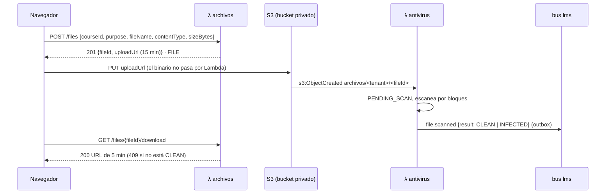

# nubeduca-ms-contenidos

Microservicio de Nubeduca: Contenido del curso: módulos, páginas e ítems, y archivos en S3 con antivirus.

Contrato: [`apis/ms-contenidos.openapi.yaml`](https://github.com/nubeduca/nubeduca-contratos/blob/main/apis/ms-contenidos.openapi.yaml) y el [catálogo de eventos](https://github.com/nubeduca/nubeduca-contratos/blob/main/eventos/catalogo.yaml) de `nubeduca-contratos`. **No se publica un evento ni se expone una ruta que no esté ahí.**

## Tareas

| Tarea | Responsable | Listo cuando |
|---|---|---|
| [CON-01 · Archivos y Media](https://github.com/nubeduca/nubeduca-backlog/issues/11) | Dev 5 @AIexander-lx | Subida a S3 con URL prefirmada y antivirus en Lambda; publica `file.scanned` y rechaza EICAR |
| [CON-02 · Contenido y Módulos](https://github.com/nubeduca/nubeduca-backlog/issues/20) | Dev 5 @AIexander-lx | Módulos, páginas e ítems con archivos de CON-01; publica `module.published` |

**Estado:** 🟢 CON-01 cerrada (probada en AWS). 🟡 CON-02 implementada: módulos, ítems, `module.published` y seed de 30.000 módulos.

## Eventos

| | |
|---|---|
| `source` | `lms.content` |
| Publica | `lms.content.file.scanned.v1` (→ ms-evaluaciones), `lms.content.module.published.v1` (→ ms-notificaciones) |
| Consume | `lms.courses.course.created.v1`, `lms.courses.enrollment.created.v1`, `lms.courses.enrollment.dropped.v1` |

## Archivos (CON-01)



- **Permisos.** `CONTENT`: el docente dueño del curso, un docente matriculado como TEACHER o un ADMIN. `SUBMISSION`: cualquier miembro del curso. Una entrega solo la ven quien la subió y los docentes del curso. Los miembros salen de las proyecciones de `course.created` y `enrollment.created/dropped`.
- **Antivirus** (`antivirus/escaner.py`). Liviano y sin dependencias: busca la firma EICAR en cualquier parte del archivo y compara el SHA-256 con una lista de bloqueados. Un archivo que pasa de 50 MB o no mide lo que se pidió en `sizeBytes` también se rechaza. Si sale `INFECTED`, se borra de S3. La interfaz `escanear(bloques) -> Resultado` permite cambiarlo por ClamAV sin tocar el handler.
- **Idempotencia.** S3 puede repetir el evento: si el ETag ya se escaneó, no se publica otra vez. Si el archivo se vuelve a subir con la URL vigente, el ETag cambia y se escanea de nuevo (versión +1 y otro `file.scanned`).

## Módulos (CON-02)

| Ruta | Quién | Qué hace |
|---|---|---|
| `GET /courses/{courseId}/modules` | miembros del curso, ADMIN | Módulos con sus ítems, por `position`. STUDENT solo ve `PUBLISHED`. |
| `POST /courses/{courseId}/modules` | docente del curso | Crea el módulo en `DRAFT`. |
| `GET /courses/{courseId}/modules/{moduleId}` | miembros del curso, ADMIN | Un módulo con sus ítems (al alumno, 404 si está en `DRAFT`). |
| `PATCH /courses/{courseId}/modules/{moduleId}` | docente del curso | Cambia `title` y/o `position`. |
| `POST /courses/{courseId}/modules/{moduleId}/items` | docente del curso | `PAGE {title, body}`, `FILE {title, fileId}` o `LINK {title, url}`, al final del módulo. 409 si el archivo no está `CLEAN`; 400 si no es `CONTENT` de este curso. |
| `POST /courses/{courseId}/modules/{moduleId}/publish` | docente del curso | Pasa a `PUBLISHED` y publica `lms.content.module.published.v1`. 409 si ya está publicado o no tiene ítems. |

"Docente del curso" es el dueño (`course.created`) o un matriculado como TEACHER. El contrato no da escritura al ADMIN. Agregar un ítem `FILE` comprueba en la misma transacción que el archivo siga `CLEAN`. La posición del ítem se asigna con una escritura condicional sobre `itemCount`, así que dos ítems simultáneos no quedan en la misma posición.

## Estructura de la tabla `<stage>-t_contenidos`

PK `tenant_id` (HASH) + `sk` (RANGE). Los ítems `EVENTO#`, `INBOX#` y `AGG#` son los de la plantilla.

**Archivo** · `sk = FILE#<fileId>`

```json
{
  "tenant_id": "utec",
  "sk": "FILE#fil_01JCQRZHQT9F4WY2JYPDV546K7",
  "entidad": "FILE",
  "version": 2,
  "fileId": "fil_01JCQRZHQT9F4WY2JYPDV546K7",
  "courseId": "crs_01JCQRZHQT9F4WY2JYPDV546K7",
  "purpose": "SUBMISSION",
  "fileName": "lab4.pdf",
  "contentType": "application/pdf",
  "sizeBytes": 1234,
  "status": "CLEAN",
  "ownerId": "a18577e2-e005-4a49-a29e-755dbf08f5b6",
  "createdAt": "2026-11-16T15:00:00Z",
  "s3Key": "archivos/utec/fil_01JCQRZHQT9F4WY2JYPDV546K7",
  "scannedAt": "2026-11-16T15:00:04Z",
  "scannedEtag": "\"9b2cf535f27731c974343645a3985328\"",
  "scannedBytes": 1234,
  "scanSignature": "-"
}
```

`status`: `PENDING_UPLOAD` → `PENDING_SCAN` → `CLEAN` | `INFECTED`. `scanSignature` es la firma encontrada (`EICAR-Test-File`, `TAMANO_NO_COINCIDE`) o `-`.

**Dueño del curso** (proyección de `course.created`) · `sk = PROY#COURSE#<courseId>`

```json
{"tenant_id": "utec", "sk": "PROY#COURSE#crs_01JCQRZHQT9F4WY2JYPDV546K7", "entidad": "PROYECCION",
 "courseId": "crs_01JCQRZHQT9F4WY2JYPDV546K7", "ownerId": "c62d9930-b473-4b1d-adec-72fdda7cf599"}
```

**Miembro del curso** (proyección de `enrollment.created`; `enrollment.dropped` la borra) · `sk = PROY#ENROLL#<courseId>#<userId>`

```json
{"tenant_id": "utec", "sk": "PROY#ENROLL#crs_01JCQRZHQT9F4WY2JYPDV546K7#a18577e2-e005-4a49-a29e-755dbf08f5b6",
 "entidad": "PROYECCION", "courseId": "crs_01JCQRZHQT9F4WY2JYPDV546K7",
 "userId": "a18577e2-e005-4a49-a29e-755dbf08f5b6", "enrollmentId": "enr_01JC5F0KPBVF7HK1VV8H23JGMW", "role": "STUDENT"}
```

**Módulo** · `sk = MODULE#<courseId>#<moduleId>`

```json
{
  "tenant_id": "utec",
  "sk": "MODULE#crs_01JCQRZHQT9F4WY2JYPDV546K7#mod_01JCJ68VGB8BCT89QZZ38VTKYP",
  "entidad": "MODULE",
  "version": 5,
  "moduleId": "mod_01JCJ68VGB8BCT89QZZ38VTKYP",
  "courseId": "crs_01JCQRZHQT9F4WY2JYPDV546K7",
  "title": "Semana 3: Serverless",
  "position": 3,
  "status": "PUBLISHED",
  "itemCount": 3,
  "createdBy": "c62d9930-b473-4b1d-adec-72fdda7cf599",
  "createdAt": "2026-11-10T15:00:00Z",
  "publishedAt": "2026-11-10T15:20:00Z",
  "publishedBy": "c62d9930-b473-4b1d-adec-72fdda7cf599"
}
```

**Ítem de un módulo** · `sk = MODULE#<courseId>#<moduleId>#ITEM#<itemId>`. Va debajo de su módulo, así que una sola consulta por prefijo trae el módulo con sus ítems (o todos los módulos del curso). Lleva `body` (PAGE), `fileId` (FILE) o `url` (LINK).

```json
{
  "tenant_id": "utec",
  "sk": "MODULE#crs_01JCQRZHQT9F4WY2JYPDV546K7#mod_01JCJ68VGB8BCT89QZZ38VTKYP#ITEM#itm_01JCQRZHQT9F4WY2JYPDV546K7",
  "entidad": "MODULE_ITEM",
  "moduleId": "mod_01JCJ68VGB8BCT89QZZ38VTKYP",
  "courseId": "crs_01JCQRZHQT9F4WY2JYPDV546K7",
  "itemId": "itm_01JCQRZHQT9F4WY2JYPDV546K7",
  "type": "FILE",
  "title": "Laboratorio 4",
  "fileId": "fil_01JCQRZHQT9F4WY2JYPDV546K7",
  "position": 2,
  "createdBy": "c62d9930-b473-4b1d-adec-72fdda7cf599",
  "createdAt": "2026-11-10T15:10:00Z"
}
```

## Seed

```bash
python scripts/poblar_datos.py --stage dev               # 30.000 módulos: UTEC 15.000, UPC 10.000, PUCP 5.000
python scripts/poblar_datos.py --stage dev --escala 0.01 # 1 % para probar
```

- 30.000 módulos en la tabla principal, cada uno con una página (`PAGE`): 70 % `PUBLISHED` y 30 % `DRAFT`. No escribe `EVENTO#`.
- Encaja con el seed de ms-cursos: el módulo *n* de cada tenant es del curso `crs_<n>` de ese seed y trae su proyección `PROY#COURSE#` con el mismo docente dueño. Así los docentes de seed ven sus módulos sin esperar `course.created`.
- Es idempotente: los ids son fijos.

## Probar

```bash
pip install -r requirements-dev.txt
python -m pytest -q        # 65 pruebas con moto, sin AWS
```

## Cómo empezar

1. Copia [`nubeduca-plantilla-servicio`](https://github.com/nubeduca/nubeduca-plantilla-servicio) a este repo (D1: un repo por microservicio). Ejemplos ya hechos: [`nubeduca-ms-usuarios`](https://github.com/nubeduca/nubeduca-ms-usuarios) y [`nubeduca-ms-cursos`](https://github.com/nubeduca/nubeduca-ms-cursos).
2. En `serverless.yml`: `service: nubeduca-ms-contenidos`, `SERVICIO: ms-contenidos`, `EVENT_SOURCE: lms.content`, tabla `${sls:stage}-t_contenidos`, y una regla, cola, DLQ y alarma para los eventos que consume. Sin línea `org:`.
3. Copia tus esquemas: `python scripts/copiar_esquemas.py --solo lms.content`.
4. Implementa las rutas del OpenAPI con pruebas (moto, sin AWS) y CI (ruff, yamllint y pytest).
5. Agrega `scripts/poblar_datos.py --stage <stage>`: 30.000 registros en la tabla principal, **UTEC 15.000, UPC 10.000 y PUCP 5.000**, sin ítems `EVENTO#`.
6. Documenta en este README la **estructura JSON de tus tablas** (lo pide la rúbrica) y publica la URL de tu API en SSM (`/nubeduca/<stage>/api/contenidos/url`).

## Desplegar

En la cuenta de integración (D2) se despliega con todo lo demás desde la VM `nubeduca-despliegue`: `scripts/desplegar.sh staging --con-seed` de [`nubeduca-backend`](https://github.com/nubeduca/nubeduca-backend), o solo este servicio con `--solo contenidos`. Mientras este repo no tenga `serverless.yml`, `desplegar.sh` lo marca como **PENDIENTE**.

Reglas del equipo: Python 3.13, Serverless Framework v4, rol `LabRole`, `tenant_id` y rol solo desde el token, ramas `<tipo>/<ID>-descripcion`, commits `<ID>: mensaje` y PRs a `main` con 1 aprobación y la CI en verde.
